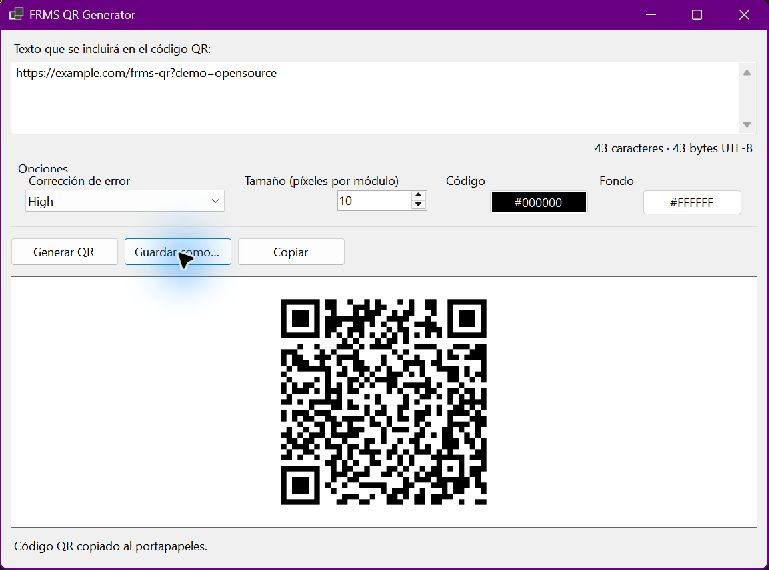

<p align="center">
  
</p>

# FRMS QR Generator

FRMS QR Generator is a small open-source Windows desktop application that
converts text into customizable QR images. Processing is local: payloads are
not uploaded or sent to a remote service.



## Features

- live QR preview before saving;
- **Save As** workflow with overwrite confirmation;
- one-click copy to the Windows clipboard;
- low, medium, quartile and high error-correction levels;
- configurable module size, foreground color and background color;
- clear validation for blank, invalid and oversized payloads;
- Unicode input and a visible UTF-8 byte counter.

> [!NOTE]
> A QR code is an encoding, not encryption. Anyone who can view the image can
> recover its payload.

## Requirements

- Windows 10 or later;
- .NET 10 SDK to build the application;
- .NET 10 Desktop Runtime only for framework-dependent builds.

## Run locally

```powershell
dotnet run --project .\FRMS-QRGenerator\FRMS-QRGenerator.csproj
```

Enter a payload, adjust the optional rendering settings and select **Generar
QR**. The result can then be saved as a PNG or copied to the clipboard.

## Build and test

```powershell
dotnet restore .\FRMS-QRGenerator.sln --locked-mode
dotnet test .\FRMS-QRGenerator.sln --configuration Release --no-restore
```

The repository wrapper performs both steps:

```powershell
.\scripts\Test.ps1
```

## Create a Windows package

Create a self-contained `win-x64` single-file package that does not require a
separate .NET installation:

```powershell
.\scripts\Publish.ps1
```

The package is written to `artifacts\publish\win-x64`. Other Windows runtime
identifiers can be selected explicitly:

```powershell
.\scripts\Publish.ps1 -Runtime win-arm64
```

Use `-FrameworkDependent` when a smaller package that requires the .NET 10
Desktop Runtime is preferred.

## Repository layout

- `FRMS-QRGenerator/` — WinForms application and QR generation service.
- `FRMS-QRGenerator.Tests/` — deterministic generation and validation tests.
- `assets/` — original project artwork.
- `docs/` — architecture, security documentation and screenshots.
- `scripts/` — build, test, packaging and publication-readiness checks.

## Contributing and security

See [CONTRIBUTING.md](CONTRIBUTING.md) before proposing a change. Security
issues should follow the private reporting process in [SECURITY.md](SECURITY.md).

Before publishing or packaging the repository, run:

```powershell
.\scripts\Test-PublicationReadiness.ps1
```

Release history is recorded in [CHANGELOG.md](CHANGELOG.md).

## License

FRMS QR Generator is available under the [MIT License](LICENSE).
